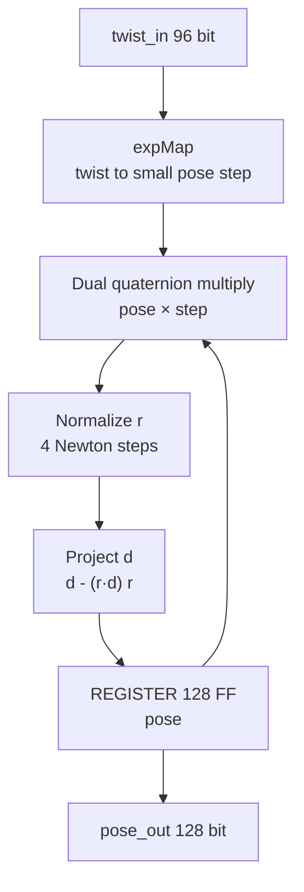
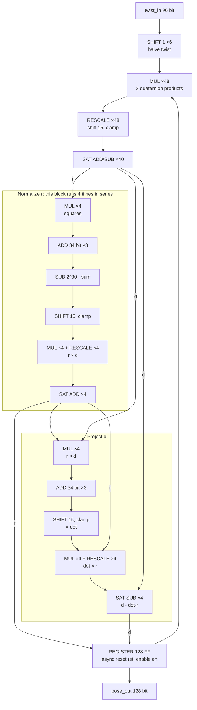
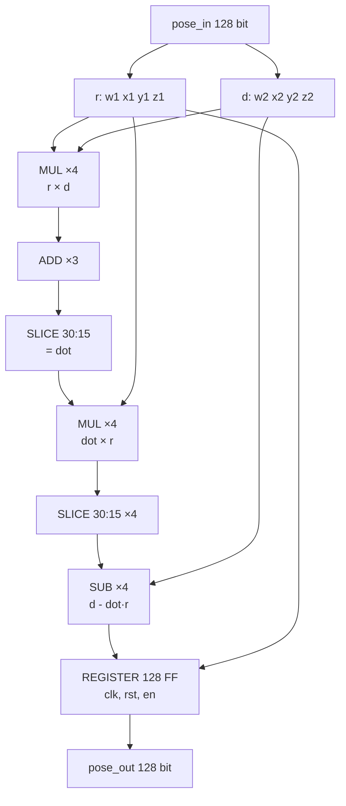

# my-kernel: SE(3) pose chip

Three Clash (Haskell) designs for a dual-quaternion pose in Q1.15 fixed point,
and one command that builds them, produces SystemVerilog and Makerchip test
files, and simulates and checks all three.

| File | What it is | Top module | Ports |
| :--- | :--- | :--- | :--- |
| `Consensus.hs` | Projection only: removes the part of `d` parallel to `r` | `kernel` | `clk rst en pose_in[127:0] pose_out[127:0]` |
| `PoseEngine.hs` | Update only: multiplies a twist step into the pose (Q1.15, saturating). No renormalization, no projection | `pose_engine` | `clk rst en twist_in[95:0] pose_out[127:0]` |
| `MasterChip.hs` | **The combined chip**: update, renormalize, project, register | `chip` | `clk rst en twist_in[95:0] pose_out[127:0]` |

## 1. Run it (GitHub Codespace)

Unzip the whole repo (the `bin/` and `sim/` folders are needed), then from
inside the `my-kernel/` folder:

```bash
bash run.sh
```

First run takes about 20-40 minutes (installs GHC 9.6.6, builds Clash 1.8.5).
It then:

1. synthesizes `Consensus.hs` to `systemverilog/Consensus.topEntity/` (required),
2. compiles `PoseEngine.hs` and `MasterChip.hs` and reports whether each compiled
   (these two never stop the script),
3. writes one Makerchip bundle per design: `makerchip_bundle.sv` (Consensus),
   `makerchip_pose_bundle.sv` and `makerchip_chip_bundle.sv`,
4. runs the local verification below and prints `ALL CHECKS PASSED.` or
   `SOME CHECKS FAILED` (exit code 1).

To re-run only the bundling and verification on the SystemVerilog that is
already generated: `SKIP_BUILD=1 bash run.sh`.

## 2. Verification

`run.sh` runs these checks (Verilator is installed with `apt` if missing):

| Check | What it does |
| :--- | :--- |
| `sim/test_quat.py` | Quaternion product in Q1.15 against exact floating-point maths: worst error, `i*j = +k`, `j*i = -k`, and `0.5 * 0.5 = 0.25`. Catches the two original `PoseEngine` bugs |
| Consensus simulation | Off-manifold pose in, projected pose out (`sim/wrapper.sv`) |
| PoseEngine simulation | 4500-cycle stress test against a bit-exact reference (`sim/wrapper_pose.sv`), plus a cross-check of the dump against the independent Python model |
| Chip simulation | 4500-cycle stress test against a bit-exact reference plus invariants (`sim/wrapper_chip.sv`), plus the same Python cross-check |

You can also paste any bundle into https://www.makerchip.com/ide. The LOG
tab ends with `Simulation PASSED!!!` on success. Makerchip's DIAGRAM tab only
draws TL-Verilog, so it shows no schematic for this design; the diagrams in
this README are drawn from the code.

## 3. The combined chip (`MasterChip.hs`)

Each clock cycle:

1. `expMap`: the twist becomes a small pose step (rotation part
   `(1, wx/2, wy/2, wz/2)`, translation part `(0, vx/2, vy/2, vz/2)`).
2. The step is multiplied into the current pose (dual quaternion product).
3. Four Newton steps keep the rotation `r` at length 1:
   `r' = r + r (1 - |r|^2) / 2`, repeated four times.
4. The projection from `Consensus.hs` removes the part of `d` parallel to `r`:
   `d' = d - (r . d) r`.
5. The result is registered. `pose_out` is the registered pose.



### Gate-level data path

Drawn from the generated `chip` module (`systemverilog/MasterChip.topEntity/chip.sv`).
"RESCALE" is a right shift by 15 followed by a clamp to the symmetric Q1.15
range. "SAT ADD/SUB" is a 16-bit saturating add or subtract. Repeated blocks
are shown once with a count.



Primitive counts in the generated chip, found by counting the generated code:

| Primitive | Count |
| :--- | :--- |
| Multipliers (16 x 16 to 32 bit) | 88 (48 pose update, 32 normalization, 8 projection) |
| 16-bit saturating add / subtract | 60 (38 add, 22 subtract) |
| 34-bit adders (sums of products) | 15 |
| Right shift by 15 (rescale) | 69 |
| Right shift by 16 / by 1 | 4 / 6 |
| Subtract from 2^30 | 4 |
| Clamp muxes (34 to 16 bit) | 73 |
| Registers | 1 (128 flip-flops, async reset, enable) |

Bit layout, MSB first (16 bits per field):

| Bus | Fields |
| :--- | :--- |
| `twist_in[95:0]` | wx, wy, wz, vx, vy, vz |
| `pose_out[127:0]` | rW, rX, rY, rZ, dW, dX, dY, dZ |

Reset pose: `r = (32767, 0, 0, 0)` (identity), `d = 0`.

Differences from `PoseEngine.hs` (needed for a correct result):

- Products are rescaled back to Q1.15 (shift right by 15, then saturate).
  `PoseEngine.hs` multiplies without rescaling, so most products saturate.
- The z component of the quaternion product uses the correct signs.
- The rotation is renormalized every cycle with four Newton steps. One step
  is enough for small twists but not for large ones (see the table below).
- The projection from `Consensus.hs` is part of the loop.

### Why four Newton steps

Bit-accurate model results (twists up to the stated size on every angular
channel, thousands of steps; worst case seen):

| Twist size | 1 step: worst `abs(r^2 - 1)` | 4 steps: worst `abs(r^2 - 1)` |
| :--- | :--- | :--- |
| up to 8000 | 0.0013 | 0.0001 |
| up to 16000 | 0.017 | 0.0001 |
| full range (+-32768) | 0.24 to 0.32 | 0.0002 |

With full-range twists and one step, `r . d` stayed off by up to 3000 LSB;
with four steps it stays within about 7 LSB while `d` is inside its range.
The cost is about 24 more multipliers than a single step, and a longer
combinational path (timing is not measured).

### Limits

- Translation components (`d`) saturate at 1.0 (32767). A twist that keeps
  pushing `d` past that leaves it on the rail, and `r . d` is then no longer small.
- `expMap` is first order. For `wx = 1000` the model rotates 6.1084 rad in
  200 steps against 6.1030 rad for the exact map (0.09% difference).
- The identity rotation is stored as 32767, which is just under 1.0.

### Test (`sim/wrapper_chip.sv`, written by `run.sh`)

A stress test with a bit-exact reference model built into the wrapper. The
reference runs beside the chip and every output is compared on every cycle,
for 4500 cycles. In addition, whenever `d` is off the rail, the chip output
must have `abs(|r|^2 - 1) <= 0.2%` and `abs(r . d) <= 16` LSB.

| Cycles | Stimulus |
| :--- | :--- |
| 40-259, 260-479, 480-699 | Rotation about x, then y, then z (a full turn each) |
| 700-999 | Translation along x, y, z |
| 1000-1199 | Rotation and translation together |
| 1200-1439 | All 8 sign combinations of the maximum angular twist |
| 1440-2399, 2403-2699, 2730-3399 | Random twists, full range on all six channels |
| 2400-2402 | Reset in the middle of a run |
| 2700-2729 | Enable low with random twists (state must hold) |
| 3400-3899 | Random full-range rotation, small translation |
| 3900-4499 | Random small twists |

`passed` goes high at cycle 4500 if nothing failed. Three flags record the
cause of a failure (`fail_cmp`, `fail_norm`, `fail_dot`) and are visible in
the waveform.

## 4. Consensus kernel (`Consensus.hs`)

One register on the projected input pose; output is the input projected,
one cycle later. No feedback loop and no saturation.



Makerchip test (`sim/wrapper.sv`): input `r = identity`, `d = (0.5, 0.5, 0, 0)`.
Expected output after the first cycle: `r.w = 32767`, `d.w = 2`, `d.x = 16384`,
`r . d = 1`.

## 5. What has been verified

| Item | Status |
| :--- | :--- |
| `Consensus.hs` compiles with Clash 1.8.5 and passes the Makerchip test | Done |
| `Consensus.hs` on 3000 random poses, unit `r`: `abs(r . d)` falls from mean 0.23 to under 1 LSB | Done (Verilator) |
| `Consensus.hs` with non-unit `r` (length 0.8) | Projection does not fully work: mean `abs(r . d)` 0.069 |
| Original `PoseEngine.hs` compiles with Clash | Done (it compiled, but its arithmetic was wrong: no Q1.15 rescaling, wrong signs in the z term) |
| Fixed `PoseEngine.hs` (Q1.15 rescaling, correct z term, explicit port names) quaternion maths against exact floating-point maths | Done: worst error 2.9 LSB over 20000 random unit pairs; the test fails on both original bugs |
| `sim/wrapper_pose.sv` and the Python model, on a stand-in `pose_engine` module | Done: 0 mismatches over 4446 update steps; the wrapper fails on a wrong z term, missing rescaling, a registered (Moore) output and an ignored enable |
| Fixed `PoseEngine.hs` compiles with Clash 1.8.5, and its generated hardware passes `sim/wrapper_pose.sv` (4500 cycles) | Done: 0 mismatches against the reference model, and 0 against the Python model over 4446 update steps |
| `MasterChip.hs` with one Newton step: compiles, and passes the simple Makerchip test (constant twist, 120 cycles) | Done |
| `MasterChip.hs` with four Newton steps (current file): bit-accurate model over thousands of steps, full-range twists | Done: `abs(r^2 - 1)` at most 0.0002, `abs(r . d)` at most about 7 LSB off the rail |
| Stress test wrapper: its reference model against the Python model over 4463 steps | Done: 0 mismatches |
| Stress test wrapper: a correct stand-in chip passes; broken stand-ins fail (wrong z sign, 3 or 1 Newton steps, no projection, bad saturation, enable ignored) | Done (stand-in modules, not the real chip) |
| `MasterChip.hs` with four Newton steps compiles with Clash 1.8.5 | Done |
| Generated chip (four Newton steps) on the full 4500-cycle stress test, in Verilator | Done: passes. 0 mismatches against the reference model over 4480 cycles and 0 against the Python model over 4463 update steps. Worst `abs(r^2 - 1)` 0.00014; worst `abs(r . d)` 3 LSB while `d` is off the rail (3286 of 4480 cycles). 4427 distinct poses seen |
| The same stress test inside Makerchip | **Not yet checked** |
| Chip through the open-source ECP5 flow (synthesis, place-and-route, bitstream) | Done: see section 7. Timing passes only at the 2.857 MHz clock it is built with |
| Chip on a board | **Not yet checked** |

FPGA synthesis, place-and-route and timing for the chip are in section 7. Nothing has been run on a board.

## 6. Layout

```
my-kernel/
├── run.sh               the whole process
├── README.md            this file
├── Consensus.hs         projection kernel
├── PoseEngine.hs        update engine (fixed)
├── MasterChip.hs        the combined chip
├── my-kernel.cabal      build setup for Clash
├── cabal.project        writes the GHC environment file Clash needs
├── bin/
│   └── Clash.hs         launcher so `cabal run clash` works
├── fpga/
│   ├── build_fpga.sh    Yosys + nextpnr-ecp5 + ecppack flow for the ULX3S
│   ├── fpga_top.v       wrapper: PLL, clock divider, serial input, folded output
│   └── ulx3s.lpf        pin constraints (check against the board schematic)
└── sim/
    ├── wrapper.sv       Makerchip test for Consensus (module kernel)
    ├── wrapper_pose.sv  Makerchip test for PoseEngine (module pose_engine)
    ├── wrapper_chip.sv  Makerchip test for the chip (module chip)
    ├── tb.sv            Verilator driver (clock, reset, cycle counter)
    ├── run_sim.sh       simulate one bundle and report PASS / FAIL
    ├── model.py         bit-accurate Python model of PoseEngine and the chip
    ├── check_dump.py    compares a simulation dump with the Python model
    └── test_quat.py     quaternion product against exact floating-point maths
```

The files in the repo are the single source: `run.sh` no longer writes copies
of them.

Generated by `run.sh`: `systemverilog/`, `makerchip_bundle.sv`,
`makerchip_pose_bundle.sv`, `makerchip_chip_bundle.sv`, `dist-newstyle/`.
Generated by `fpga/build_fpga.sh`: `fpga/out/`.

## 7. FPGA build (ULX3S, Lattice ECP5 LFE5U-85F-6BG381C)

```bash
bash run.sh              # produces systemverilog/ and checks the simulation
bash fpga/build_fpga.sh  # Yosys, nextpnr-ecp5, ecppack
```

Open-source flow (Yosys 0.33, nextpnr-ecp5 0.6, Project Trellis). Yosys reads
the generated SystemVerilog directly. The chip has 227 I/O bits, more than the
board has pins, so `fpga/fpga_top.v` fills `twist_in` from a serial shift
register and folds `pose_out` to one observed bit; no logic is optimized away.

Results for the chip (`MasterChip.hs`, four Newton steps):

| Item | Result |
| :--- | :--- |
| Synthesis and place-and-route | Both complete; bitstream written (about 391 kB) |
| Hardware multipliers (MULT18X18D) | 84 of 156 (53%). 88 multipliers in the design; 4 multiply by the constant 0 and are removed |
| Logic cells (TRELLIS_COMB) | 6644 of 83640 (7%): 3670 LUT4, 1155 carry cells (CCU2C), 500 PFUMX, 194 L6MUX21 |
| Flip-flops | 225 of 83640 (128 pose state, 96 input shift register, 1 output fold) |
| PLL | 1 of 4 |
| Timing at the board's 25 MHz | **Fails: Fmax 4.13 MHz.** The critical path is 242 ns (100 ns logic, 142 ns routing) from the pose register through about 11 multipliers in series back to the pose register |
| Timing as built | Passes: the chip runs at **2.857 MHz** (25 MHz board clock, PLL to 10 MHz, divided by 3.5). Fmax over four placement seeds: 3.63 to 3.95 MHz |

The PLL output must be at least 10 MHz, and the ECP5 clock divider only
divides by 2 or 3.5, which is why the chip clock is 2.857 MHz and not an
even 3 MHz or 3.125 MHz.

At 2.857 MHz the chip completes one pose update per clock, about 2.9 million
updates per second. Not yet done: the chip has not been run on a board, and
`fpga/ulx3s.lpf` was written from the ULX3S documentation as remembered, so
check every pin site against the board schematic before programming.

Next steps for speed: the cost is the single combinational path. The four
Newton steps (8 of the 11 multipliers in series) are the obvious thing to
restructure, for example by reusing one Newton stage over several clock
cycles. That changes latency and throughput, so the design would return to
the verification steps in section 5 before the FPGA flow is repeated.
