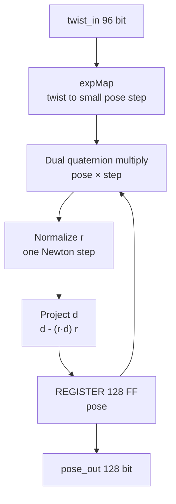
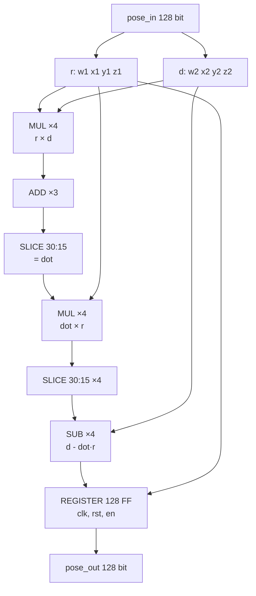

# my-kernel: SE(3) pose chip

Three Clash (Haskell) designs for a dual-quaternion pose in Q1.15 fixed point,
and one command that builds them and produces SystemVerilog and Makerchip
test files.

| File | What it is | Top module | Ports |
| :--- | :--- | :--- | :--- |
| `Consensus.hs` | Projection only: removes the part of `d` parallel to `r` | `kernel` | `clk rst en pose_in[127:0] pose_out[127:0]` |
| `PoseEngine.hs` | Update only: multiplies a twist step into the pose (saturating) | default | default Clash names |
| `MasterChip.hs` | **The combined chip**: update, renormalize, project, register | `chip` | `clk rst en twist_in[95:0] pose_out[127:0]` |

## 1. Run it (GitHub Codespace)

Put `run.sh`, `Consensus.hs`, `PoseEngine.hs` and `MasterChip.hs` in one
folder, then:

```bash
bash run.sh
```

First run takes about 20-40 minutes (installs GHC 9.6.6, builds Clash 1.8.5).
`run.sh` writes everything else it needs (the Cabal files, the launcher and the
Makerchip test wrappers), so these four files are the whole repo. It then:

1. synthesizes `Consensus.hs` to `systemverilog/Consensus.topEntity/` and writes
   `makerchip_bundle.sv`,
2. compiles `PoseEngine.hs` and reports whether it compiled,
3. compiles `MasterChip.hs` and, if it compiled, writes
   `makerchip_chip_bundle.sv`.

The PoseEngine and MasterChip steps never stop the script. The Consensus step
is required.

## 2. Verify in Makerchip

1. Open a bundle file in the Codespace, select all, copy.
2. In https://www.makerchip.com/ide, select all in the editor, delete, paste.
3. The LOG tab ends with `Simulation PASSED!!!` on success.

Makerchip's DIAGRAM tab only draws TL-Verilog, so it shows no schematic for
this design. The diagrams below are drawn from the code.

## 3. The combined chip (`MasterChip.hs`)

Each clock cycle:

1. `expMap`: the twist becomes a small pose step (rotation part
   `(1, wx/2, wy/2, wz/2)`, translation part `(0, vx/2, vy/2, vz/2)`).
2. The step is multiplied into the current pose (dual quaternion product).
3. One Newton step keeps the rotation `r` at length 1:
   `r' = r + r (1 - |r|^2) / 2`.
4. The projection from `Consensus.hs` removes the part of `d` parallel to `r`:
   `d' = d - (r . d) r`.
5. The result is registered. `pose_out` is the registered pose.



Bit layout, MSB first (16 bits per field):

| Bus | Fields |
| :--- | :--- |
| `twist_in[95:0]` | wx, wy, wz, vx, vy, vz |
| `pose_out[127:0]` | rW, rX, rY, rZ, dW, dX, dY, dZ |

Reset pose: `r = (32767, 0, 0, 0)` (identity), `d = 0`.

Differences from `PoseEngine.hs` (needed for a correct result):

- Products are rescaled back to Q1.15 (shift right by 15, then saturate).
  `PoseEngine.hs` multiplies without rescaling, so most products saturate.
- The z component of the quaternion product uses the correct signs.
- The rotation is renormalized every cycle.
- The projection from `Consensus.hs` is part of the loop.

Range limit: translation components (`d`) saturate at 1.0 (32767). A twist
that pushes `d` past that leaves it on the rail, and `r . d` stops being small.

### Test (`sim/wrapper_chip.sv`, written by `run.sh`)

Constant twist `wx = 1000, vy = 100`. From cycle 120 on, `passed` goes high if
the rotation has moved, `|r|` is within 0.2% of 1, and `|r . d|` is at most 8 raw
units.

## 4. Consensus kernel (`Consensus.hs`)

One register on the projected input pose; output is the input projected,
one cycle later. No feedback loop and no saturation.



Makerchip test (`sim/wrapper.sv`): input `r = identity`, `d = (0.5, 0.5, 0, 0)`.
Expected output after the first cycle: `r.w = 32767`, `d.w = 2`, `d.x = 16384`,
`r . d = 1`.

## 5. What has been verified

| Item | Status |
| :--- | :--- |
| `Consensus.hs` compiles with Clash 1.8.5 and passes the Makerchip test | Done |
| `Consensus.hs` on 3000 random poses, unit `r`: `|r . d|` falls from mean 0.23 to under 1 LSB | Done (Verilator) |
| `Consensus.hs` with non-unit `r` (length 0.8) | Projection does not fully work: mean `|r . d|` 0.069 |
| `MasterChip.hs` algorithm, bit-accurate Python model, thousands of steps | `|r|` within 0.0002 of 1; `|r . d|` at most about 2 LSB while `d` is in range |
| `MasterChip.hs` compiles with Clash | **Not yet checked** |
| `MasterChip.hs` passes the Makerchip test | **Not yet checked** |
| `PoseEngine.hs` compiles | **Not yet checked** |
| `PoseEngine.hs` arithmetic is correct | No: products are not rescaled and the z term has wrong signs |

Nothing here has been run on an FPGA, so timing and area are unknown.

## 6. Layout

```
my-kernel/
├── run.sh               the whole process
├── README.md            this file
├── Consensus.hs         projection kernel
├── PoseEngine.hs        update engine (as originally written)
├── MasterChip.hs        the combined chip
├── my-kernel.cabal      build setup for Clash
├── cabal.project        writes the GHC environment file Clash needs
├── bin/
│   └── Clash.hs         launcher so `cabal run clash` works
└── sim/
    ├── wrapper.sv       Makerchip test for Consensus (module kernel)
    └── wrapper_chip.sv  Makerchip test for the chip (module chip)
```

`run.sh` rewrites the Cabal files, `bin/` and `sim/` on every run, so they can
also be deleted and regenerated.

Generated by `run.sh`: `systemverilog/`, `makerchip_bundle.sv`,
`makerchip_chip_bundle.sv`, `dist-newstyle/`.
