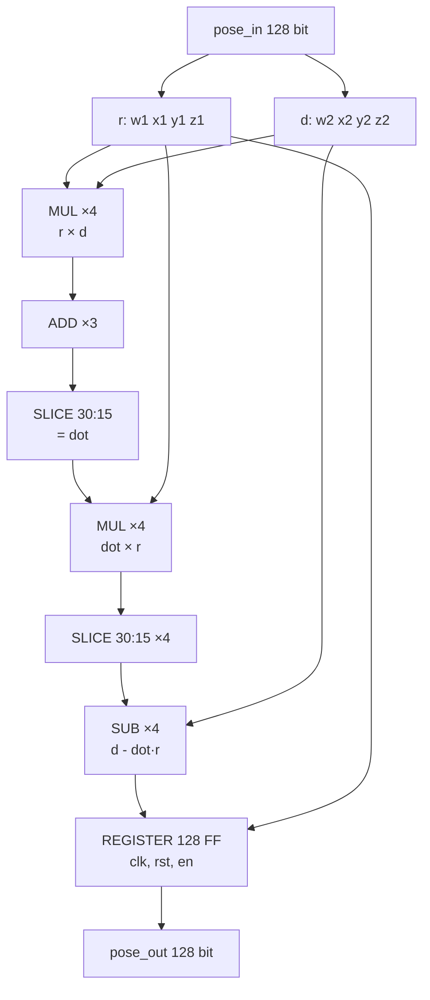

# my-kernel: SE(3) Consensus Kernel

A small Clash (Haskell) design that takes a dual-quaternion pose, projects it
back onto the SE(3) manifold, and registers the result. One command builds it,
synthesizes it to SystemVerilog, and produces a single file you can simulate
in Makerchip.

- Language: Haskell, compiled to hardware by Clash 1.8.5
- Toolchain: GHC 9.6.6, Cabal (installed by `run.sh` through ghcup)
- Output: SystemVerilog (`systemverilog/`) and one bundled file (`makerchip_bundle.sv`)
- Verified: Makerchip simulation prints `Simulation PASSED!!!`; an independent
  Verilator simulation gives the same values

## 1. What the design does

Source: `Consensus.hs`, module `Consensus`.

- Number format: Q1.15, stored as `Signed 16`. The value 32767 is just under 1.0.
- A pose is a dual quaternion: a real quaternion `r` and a dual quaternion `d`,
  each with four 16-bit components (w, x, y, z). Total 8 x 16 = 128 bits.
- `projectSE3` removes the part of `d` that is parallel to `r`:
  `d' = d - (r . d) r`. After this, `r . d` is approximately 0, which is the
  orthogonality condition for a unit dual quaternion.
- `qDot` computes the 4-term dot product with 32-bit products and keeps bits
  [30:15] to return to Q1.15. `qScale` does the same for a single multiply.
- `topEntity` is one register (`register initialPose`) fed by the projected
  input pose. Output is the input pose projected, one clock cycle later.
- Reset value (identity pose): `r = (32767, 0, 0, 0)`, `d = (0, 0, 0, 0)`.

What it does not do: there is no internal feedback loop, no saturating
arithmetic, no dynamics or physics, and no renormalization of `r`. It
projects `d` only. The 32-bit sum in the dot product is not saturated, so
very large inputs could wrap.

## 2. Ports (module `kernel`)

The `ANN topEntity` pragma in `Consensus.hs` fixes the module and port names so
the test wrapper always connects.

| Port | Direction | Width | Meaning |
| :--- | :--- | :--- | :--- |
| `clk` | in | 1 | Clock |
| `rst` | in | 1 | Reset, active high, asynchronous |
| `en` | in | 1 | Enable |
| `pose_in` | in | 128 | Input pose |
| `pose_out` | out | 128 | Projected pose, registered |

Pose bus layout (128 bits, MSB first, same for `pose_in` and `pose_out`):

| Bits | Field | Bits | Field |
| :--- | :--- | :--- | :--- |
| [127:112] | r.w | [63:48] | d.w |
| [111:96] | r.x | [47:32] | d.x |
| [95:80] | r.y | [31:16] | d.y |
| [79:64] | r.z | [15:0] | d.z |

## 3. Gate-level data path

Drawn from the generated `kernel.sv`. Repeated blocks are shown once with a
count (x4). Multipliers produce 32-bit results; each slice keeps bits 30:15
to return to Q1.15. This diagram was made by reading the generated code; it
is not the output of a synthesis tool.



## 4. Repository layout

```
my-kernel/
├── run.sh              the whole process
├── README.md           this file
├── Consensus.hs        the design; the only file Clash synthesizes
├── my-kernel.cabal     build setup for Clash
├── cabal.project       writes the GHC environment file Clash needs
├── bin/
│   └── Clash.hs        small launcher so `cabal run clash` works
└── sim/
    └── wrapper.sv      Makerchip test wrapper (module top)
```

`bin/` and `sim/` must stay as folders. `run.sh` and the Cabal file refer to
them by path.

Generated by `run.sh` (not part of the source):

```
systemverilog/Consensus.topEntity/kernel.sv         the synthesized module
systemverilog/Consensus.topEntity/kernel_types.sv   struct types for the pose
makerchip_bundle.sv                                 types + kernel + wrapper
dist-newstyle/                                      Cabal build output
.ghc.environment.*                                  written by cabal.project
```

## 5. Run it (GitHub Codespace)

From inside the `my-kernel/` folder:

```bash
bash run.sh
```

What the script does, in order:

1. Installs ghcup, GHC and Cabal if `~/.ghcup/env` is missing. ghcup installs
   its default GHC (9.10.3) first; the script then installs GHC 9.6.6 and
   sets it as the active version. This is normal.
2. Runs `cabal update`.
3. Runs `cabal build`, which builds about 130 packages including Clash. This
   is the slow step: roughly 20-40 minutes the first time, with long silent
   stretches while large packages compile. CPU at 100% is expected. Later runs
   reuse the cached build.
4. Deletes `systemverilog/` and runs
   `cabal run clash -- --systemverilog Consensus.hs`.
5. Concatenates the generated files into `makerchip_bundle.sv`, types file
   first, then the kernel, then `sim/wrapper.sv`.
6. Prints `DONE.`

Clash writes `.sv` files to `systemverilog/`, not `verilog/`. The script
searches that folder.

Notes for iPad / Safari: keep the Codespaces tab open and the screen awake.
To protect the build from a dropped tab, start it with
`nohup bash run.sh > build.log 2>&1 &` and follow progress with
`tail -n 20 build.log`.

## 6. Verify in Makerchip

1. Open `makerchip_bundle.sv` in the Codespace, select all, copy.
2. Go to https://www.makerchip.com/ide. Click in the editor, select all,
   delete, paste. Line 1 should read `package kernel_types;`.
3. Makerchip compiles and simulates automatically (the small E button at the
   top right of the editor starts it by hand). Open the LOG tab. A successful
   run ends with `Simulation PASSED!!!`.
4. Optional: open the WAVEFORM tab and expand `dut` to see `pose_in` and
   `pose_out`.

Makerchip's DIAGRAM tab only draws TL-Verilog designs. For this plain
SystemVerilog design it shows only the scaffolding signals (`*reset`,
`*passed`, `*failed`, `*cyc_cnt`). The schematic is in section 3.

Two harmless warnings appear in the log: `TIMESCALEMOD` (the Clash code has a
`timescale` line and Makerchip's wrapper does not). They do not affect the
result.

## 7. What the test checks

`sim/wrapper.sv` defines `module top(clk, reset, cyc_cnt, passed, failed)`,
the interface Makerchip expects. It instantiates `kernel` and feeds a constant
off-manifold pose:

| Component | Raw value | Meaning |
| :--- | :--- | :--- |
| r | `7FFF, 0, 0, 0` | identity rotation |
| d | `4000, 4000, 0, 0` | d.w = 0.5, d.x = 0.5 |

Here `r . d = 0.5`, so the input is off the manifold. From cycle 10 on,
`passed` is high if `r.w == 32767` and `|r . d| <= 4` raw units; otherwise
`failed` is high.

Expected output after the first clock cycle (values stay constant):

| Signal | Value |
| :--- | :--- |
| r.w | 32767 (unchanged) |
| d.w | 2 (was 16384) |
| d.x | 16384 (unchanged) |
| r . d | 1 |

An independent Verilator simulation of the generated kernel produced exactly
these values, and the check also confirmed `d.x == 16384`, which the
Makerchip wrapper does not test.

Limits of the test: it uses one pose, and a kernel that outputs
a rotation of 32767 with a small `r . d` would also pass the wrapper's check.
It shows the projection works for this input, not that it is correct for all
inputs.

## 8. Design history

Earlier notes for this project described a "master kernel" with Langevin
dynamics, saturating arithmetic, a feedback loop, an `SFixed 16 16` variant,
and "negotiated consensus" states. None of that is in `Consensus.hs`, and none
of it is documented here. This README describes only what the code in this
repository does and what was run.
